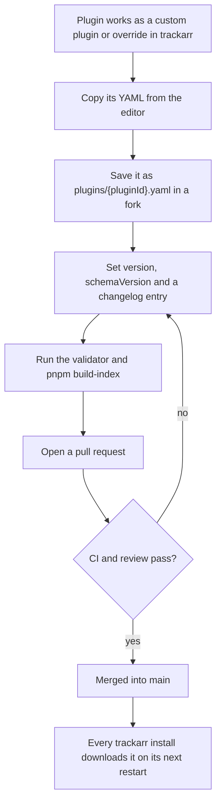

# Contributing

This guide covers the plugin YAML format, the `version` and `schemaVersion` rules, how to test a
plugin, and how to submit one. [README.md](README.md) explains the repository and how trackarr
downloads it.

## Contents

- [The plugin file](#the-plugin-file)
- [Plugin bases](#plugin-bases)
- [Field reference](#field-reference)
- [Version rules](#version-rules)
- [Testing a plugin](#testing-a-plugin)
- [Submitting a plugin](#submitting-a-plugin)

## The plugin file

Each plugin is one file, `plugins/<pluginId>.yaml`. The engine runs it like this:

1. The user creates an integration and fills in the fields the plugin declares, plus the
   engine-owned ones: the base URL (one of `baseUrls`), the sync schedule and the required ratio.
2. On each sync, the engine sends the plugin's `steps` in order, against the chosen base URL, with
   the `http` headers and cookies.
3. After each response it checks `authFailure`, then extracts values with regexes or JSON paths.
4. `mapping` turns the extracted values into trackarr's stats, and `dashboard` picks which stats
   the tracker card shows.

A sync ends with one of three outcomes: `success`, `authFailed` (the credentials are wrong or
expired) or `unknownError` (anything else: a non-2xx response, a regex that did not match, a value
that did not parse).

A complete example, `plugins/fearnopeer.yaml`, abridged:

```yaml
pluginId: fearnopeer
displayName: Fearnopeer
version: 1.0.0
schemaVersion: 1
changelog:
  - version: 1.0.0
    date: "2026-11-07"
    notes: First release in the trackarr-plugins repository.

baseUrls:
  - https://fearnopeer.com/

fields:
  - name: apiKey
    label: API Key
    type: password
    required: true
    sensitive: true

http:
  headers:
    Accept: application/json

steps:
  - name: user
    method: GET
    url: "api/user?api_token={{apiKey}}"
    responseType: json
    extract:
      username:
        path: "username"
      uploaded:
        path: "uploaded"
        transform: byteSize
      downloaded:
        path: "downloaded"
        transform: byteSize
      ratio:
        path: "ratio"
        transform: decimal
      seeding:
        path: "seeding"
        transform: integer
      leeching:
        path: "leeching"
        transform: integer
    validate:
      - field: username
        rule: notEmpty
        onFail: unknownError

mapping:
  ratio: "steps.user.ratio"
  uploadedBytes: "steps.user.uploaded"
  downloadedBytes: "steps.user.downloaded"
  requiredRatio: "fields.required_ratio"
  seedingTorrents: "steps.user.seeding"
  leechingTorrents: "steps.user.leeching"
  activeTorrents: "steps.user.seeding + steps.user.leeching"

dashboard:
  metrics:
    - stat: uploadedBytes
      label: Uploaded
      format: bytes
      icon: arrow-up
      tone: success
```

Rules for the file itself:

- The file name is the `pluginId` plus `.yaml`. `.yml` and other files are rejected.
- Keys are camelCase. An unknown key is an error, not a warning.
- Keep LF line endings. The file's bytes are hashed, so any byte change, a comment included, is a
  new version (see [Version rules](#version-rules)).
- Comments are allowed and kept: trackarr shows the file exactly as written.

## Plugin bases

Trackers that run the same software answer the same way, so their plugins differ only in the name
and the address. A base, in `bases/<baseId>.yaml`, holds what they share, and each plugin extends it.
`bases/unit3d.yaml` is the base of every UNIT3D tracker, and a UNIT3D plugin is only this:

```yaml
pluginId: aither
displayName: Aither
version: 1.0.0
schemaVersion: 2
changelog:
  - version: 1.0.0
    date: "2026-11-08"
    notes: First release, built on the UNIT3D base.

extends: unit3d

baseUrls:
  - https://aither.cc/
```

How trackarr combines them:

- The base can hold `fields`, `customFields`, `http`, `authFailure`, `steps`, `mapping` and
  `dashboard`. Each one the plugin does not set comes from the base.
- A key the plugin sets replaces the base's key whole; the two are not merged. To add one dashboard
  tile, the plugin repeats the whole `dashboard`.
- The identity of the plugin (`pluginId`, `displayName`, `version`, `changelog`) and its `baseUrls`
  always come from the plugin.
- A plugin with `extends` needs `schemaVersion: 2`.

A base file has its own header instead of the plugin's:

| Key | Required | Description |
| --- | --- | --- |
| `baseId` | yes | The id plugins use in `extends`. Same format as `pluginId`; the file name equals it. |
| `displayName` | no | The name What's New shows for the base, for example `UNIT3D`. |
| `version` | yes | The base's semantic version. Same [rules](#version) as a plugin's. |
| `schemaVersion` | yes | `2` or later. |
| `changelog` | expected here | Same format as a plugin's. Shown in What's New when the base changes. |

Rules for a base:

- It must be complete: a plugin that only sets its header, `extends` and `baseUrls` must be valid.
  The validator checks this.
- `pluginId`, `baseUrls`, `extends` and any other key are rejected.
- A change to the base reaches every plugin that extends it, on every install, overrides and
  custom plugins included, without a new plugin version. Test it with more than one of its plugins,
  and say in its changelog what changed.
- Add a base when a second plugin would copy most of another one. Until then, a plugin with no
  `extends` is simpler.

## Field reference

### Top level

| Key | Required | Description |
| --- | --- | --- |
| `pluginId` | yes | Stable id used by integrations, the API and the file name. Must match `^[a-z0-9]+(-[a-z0-9]+)*$`: lowercase letters and digits, separated by single hyphens. It can never be renamed: a new id is a new plugin. |
| `displayName` | yes | The name shown in the UI. |
| `version` | yes | The plugin's semantic version, for example `1.2.0`. See [Version rules](#version-rules). |
| `schemaVersion` | yes | The integer YAML format version the plugin uses: `2` for a plugin with `extends`, otherwise `1`. See [Version rules](#version-rules). |
| `extends` | no | The `baseId` of a [plugin base](#plugin-bases). The plugin inherits every base key it does not set. |
| `changelog` | expected here | List of release notes, one entry per version, newest first. The engine does not require it, but every plugin in this repository has one. Shown in trackarr's What's New and on the outdated-override screen. |
| `baseUrls` | yes | At least one URL. The user picks one when creating an integration; it becomes the base of every step URL. |
| `fields` | no | The inputs the user fills in when creating an integration, usually credentials. |
| `customFields` | no | More inputs, same shape as `fields`. Use it for non-credential settings such as a username. |
| `http` | no | Headers and cookies sent with every step. |
| `authFailure` | no | How to recognise a logged-out response. |
| `steps` | yes, unless inherited | At least one HTTP request, run in order. |
| `mapping` | yes, unless inherited | How extracted values become trackarr's stats. |
| `dashboard` | yes, unless inherited | What the tracker card shows. |

### `changelog[]`

| Key | Required | Description |
| --- | --- | --- |
| `version` | yes | The plugin version the entry describes. |
| `date` | yes | Release date as `"YYYY-MM-DD"`. Quote it so YAML keeps it a string. |
| `notes` | yes | One or two sentences a user can read: what changed and whether they must do anything. |

### `baseUrls`

Full URLs ending in `/`, for example `https://tracker.example/`. List every domain the tracker
answers on (mirrors, an old and a new domain). An integration whose base URL is no longer in the
list reports a configuration error and asks the user to pick a new one, so remove an entry only
when that domain is really gone.

### `fields[]` and `customFields[]`

| Key | Required | Default | Description |
| --- | --- | --- | --- |
| `name` | yes | | Key used in templates (`{{name}}`) and mappings (`fields.name`). |
| `label` | yes | | Label of the form input. |
| `description` | no | | Help text shown under the input, for example how to copy a cookie. |
| `type` | no | `text` | `text`, `password` or `number`. |
| `required` | no | `false` | The form refuses to save without a value. |
| `sensitive` | no | `false` | The value is a secret: the input is masked and the value is never shown back. Set it on every cookie, API key or password. |

The names `cron`, `required_ratio` and `baseUrl` are engine-owned. The engine adds them to every
plugin; declaring them is an error. Their values are still usable: `fields.required_ratio` in
`mapping`, for example.

### `http`

| Key | Description |
| --- | --- |
| `headers` | Map of header name to value, sent with every step. Values can use `{{fieldName}}`, for example `Cookie: "{{cookie}}"`. |
| `cookies` | Map of cookie name to value, joined into one `Cookie` header. Values can use `{{fieldName}}`. |

`http.baseUrl` and the `User-Agent` header are engine-owned and rejected.

### `authFailure`

| Key | Description |
| --- | --- |
| `htmlPatterns` | List of strings. If any step's response body contains one (case-insensitive), the sync ends with `authFailed`. Use text that only a login page has, such as `name="password"`. |

A response with HTTP status 401 or 403 always ends with `authFailed`. `authFailure.httpStatusCodes`
is engine-owned and rejected.

### `steps[]`

| Key | Required | Default | Description |
| --- | --- | --- | --- |
| `name` | yes | | Step name, unique within the plugin. Later steps and `mapping` refer to it as `steps.<name>.<key>`. |
| `method` | no | `GET` | `GET`, `POST`, `PUT` or `DELETE`. Steps have no request body. |
| `url` | yes | | Path relative to the chosen base URL, without a leading `/`, for example `"user.php?id={{userId}}"`. |
| `responseType` | no | `html` | `json` parses the body as JSON and enables `path`; anything else treats it as text. |
| `extract` | no | | Map of key to extraction rule. |
| `validate` | no | | List of checks on the extracted values. |

Templates in `url`: `{{name}}` or `{{fields.name}}` inserts a field value, `{{steps.<step>.<key>}}`
inserts a value extracted by an earlier step. Inserted values are URL-encoded.

A non-2xx response that is not an auth failure ends the sync with `unknownError`.

### `steps[].extract.<key>`

Each key names one extracted value. Give exactly one of `regex` or `path`.

| Key | Description |
| --- | --- |
| `regex` | A .NET regular expression, run case-insensitive and single-line (`.` matches newlines). The value is the group named like the key, else the group named `value`, else the first named group, else group 1, else the whole match. No match ends the sync with `unknownError`. In YAML double-quoted strings, escape `\` as `\\` and `"` as `\"`. |
| `path` | Dot-separated property names in a JSON response, for example `stats.uploaded`. Names are case-insensitive. Array indexes are not supported. A missing property ends the sync with `unknownError`. |
| `countMatches` | With `regex`: `true` returns the number of matches instead of a value, for example to count torrent rows. |
| `transform` | Converts the raw value; see below. Without it, the value is trimmed. |

| Transform | Input | Output |
| --- | --- | --- |
| `byteSize` | A number, a space and a unit: `B`, `KB`, `KiB`, `MB`, `MiB`, `GB`, `GiB`, `TB`, `TiB`, `PB`, `PiB` (case-insensitive), for example `1,5 TiB`. | Whole bytes. |
| `decimal` | A number, with `.` or `,` as decimal separator, and an optional `K`, `M` or `B` suffix (thousand, million, billion). Also `∞`, `inf` or `infinity`. | Decimal number, or `∞`. Only `ratio` accepts `∞`: it is stored as no ratio and shown as ∞ (trackarr 0.5.2 and later). |
| `integer` | A whole number; `.` and `,` thousands separators are removed. | Integer. |
| `toString` | Any text. | The text, trimmed. |

### `steps[].validate[]`

| Key | Required | Default | Description |
| --- | --- | --- | --- |
| `field` | yes | | An `extract` key of the same step. |
| `rule` | yes | | `notEmpty`: the value must not be empty or whitespace. |
| `onFail` | no | `unknownError` | Outcome when the rule fails: `authFailed` or `unknownError`. |

Use it when a logged-out page still answers 200 and matches nothing in `authFailure`, for example
an API that returns an empty username for a bad key.

### `mapping`

Each key is one of trackarr's stats. Each value is an expression: one or more operands joined by
`+`. An operand is `steps.<step>.<key>`, `fields.<name>`, a bare field name, or a literal number.

| Stat | Required | Type | Description |
| --- | --- | --- | --- |
| `ratio` | yes | decimal | Share ratio. |
| `uploadedBytes` | yes | whole bytes | Use `byteSize` when the tracker shows `1.2 TiB`. |
| `downloadedBytes` | yes | whole bytes | Same as above. |
| `requiredRatio` | yes | decimal | Normally `"fields.required_ratio"`, the engine-owned field. |
| `seedingTorrents` | yes | integer | |
| `leechingTorrents` | yes | integer | |
| `activeTorrents` | yes | integer | Usually `"steps.x.seeding + steps.x.leeching"`. |
| `seedBonus` | no | text | Shown as is. |
| `buffer` | no | text | Shown as is. |
| `hitAndRuns` | no | integer | |

A missing required stat, or a value that does not parse as its type, ends the sync with
`unknownError`.

### `dashboard`

| Key | Required | Default | Description |
| --- | --- | --- | --- |
| `byteUnitSystem` | no | `binary` | `binary` shows bytes as KiB, MiB, GiB; `decimal` as KB, MB, GB. |
| `metrics` | yes | | At least one tile for the tracker card. |

`dashboard.metrics[]`:

| Key | Required | Default | Description |
| --- | --- | --- | --- |
| `stat` | yes | | One of the `mapping` stats above. |
| `label` | yes | | Tile title. |
| `format` | no | `text` | `bytes`, `count` or `text`. |
| `icon` | no | | `arrow-up`, `arrow-down`, `coins`, `hard-drive` or `shield-alert`. Anything else shows a generic chart icon. |
| `tone` | no | `primary` | Icon colour: `success`, `primary`, `warning`, `destructive` or `muted`. |

The card always shows the ratio against the required ratio, so `ratio` needs no tile.

## Version rules

### `version`

- It is a [semantic version](https://semver.org/): `MAJOR.MINOR.PATCH`, for example `1.2.0`.
- **Every change to a plugin file must increase it.** trackarr compares the file's SHA-256, so even
  a comment-only change reaches users as an update. CI fails a pull request that changes a plugin
  without a strictly greater `version`.
- Add a `changelog` entry for the new version, at the top of the list.
- Choose the part to bump by what the user has to do:
  - **patch** (`1.0.1`): a fix with no visible change, such as a regex updated after a site change;
  - **minor** (`1.1.0`): something new that needs no action, such as a new metric or an optional
    field;
  - **major** (`2.0.0`): the user must act, such as a new required field or a removed base URL.
    Say what to do in the changelog notes.
- `main` is the only channel. Do not publish prerelease versions (`1.1.0-beta.1`): every install
  would receive them.
- A new plugin starts at `1.0.0`.

### `schemaVersion`

- It is an integer, at least `1`, that names the YAML format the plugin uses. Schema version `2`
  adds `extends` and [plugin bases](#plugin-bases) (trackarr 0.6 and later); everything else in
  this guide is schema version `1`.
- trackarr runs every schema version up to the one it supports (`SupportedPluginSchemaVersion`).
  Every change to the YAML format increments it, and this guide is updated with it.
- trackarr refuses a plugin whose `schemaVersion` is greater than the one it supports. When an
  official plugin moves to a newer schema, installs on older trackarr keep the last compatible
  version and ask the user to update trackarr.
- So use the lowest schema version that has every feature the plugin needs, and raise it only in
  the same release that starts using a new feature. Raising it is a change, so `version` increases
  too.

## Testing a plugin

You need Node 22+ with [pnpm](https://pnpm.io/), and the
[.NET 10 SDK](https://dotnet.microsoft.com/download) with a clone of
[trackarr](https://github.com/leandrobattochio/trackarr) for the validator.

### 1. Validate the file

Run the trackarr validator, which applies the same rules as the app (schema, `pluginId` format,
engine-owned fields, `version` and `schemaVersion`) and checks that each file name equals its
`pluginId`. `--bases bases` also checks every base and resolves `extends` with them:

```bash
dotnet run --project ../trackarr/backend/tools/TrackerStats.PluginValidator -- --bases bases plugins/*.yaml
```

It prints `OK` or `INVALID` with the reason for each file, and exits non-zero when any file is
invalid. Adjust `../trackarr` to where you cloned it.

### 2. Build the index

```bash
pnpm install
pnpm build-index
```

This regenerates `index.json` and fails on a duplicate id, a file name that differs from its id,
an `extends` that names no file in `bases/`,
a malformed `version`, `schemaVersion` or `changelog`, or a plugin whose content changed since
your last commit without a higher `version`. CI runs the same check against the target branch.

### 3. Run it against the tracker with Test

The validator only checks the format. To check that the regexes and paths really match the
tracker, use the **Test** button in trackarr's plugin editor. It validates the YAML, then runs it
once with the settings of an integration you pick, and shows the outcome, the HTTP status of each
step, the extracted stats and the first field that failed. It saves no snapshot and does not
change the integration. Test needs an integration of that plugin:

- **Changing an official plugin:** open it on the Plugins page and edit it. Saving creates an
  override, which only your install uses. Pick an existing integration of that plugin and press
  **Test**.
- **A new plugin:** create it with **New plugin**, paste your YAML and save; it becomes a custom
  plugin. Create an integration for it with your tracker credentials, then return to the editor
  and press **Test**.

Credentials stay in your trackarr instance. Never paste a cookie, API key or test response that
contains one into an issue or pull request.

### 4. Optional: load the repository as the plugin source

To see your branch exactly as users will receive it, point trackarr at your clone and restart it:

```bash
PluginSource__Url=file:///path/to/trackarr-plugins/
```

Run `pnpm build-index` first: trackarr rejects any file whose SHA-256 does not match
`index.json`. An override or custom plugin with the same id still wins over the official one, so
remove it before testing this way.

## Submitting a plugin

New plugins and fixes are submitted as pull requests to this repository. trackarr cannot open them
for you.



### Promote a custom plugin

1. Make sure it works: **Test** returns `success` with the stats you expect.
2. Fork this repository and create a branch.
3. Copy the YAML from trackarr's editor into `plugins/<pluginId>.yaml`. Keep the same `pluginId`
   so your integrations keep pointing at it, unless an official plugin already has that id.
4. Set `version: 1.0.0`, `schemaVersion: 1` and a `changelog` entry for `1.0.0` dated today. If
   the tracker runs software that already has a base, such as UNIT3D, copy a plugin that extends
   it instead and change only `pluginId`, `displayName`, `changelog` and `baseUrls`.
5. Check that every credential field has `sensitive: true` and a `description` that tells a new
   user where to find the value.
6. Run the validator and `pnpm build-index`, and commit the plugin with the regenerated
   `index.json`. CI fails when `index.json` is out of date.
7. Open a pull request. Describe the tracker, which account types you tested with, and paste the
   Test outcome without any secret.

After the merge, your install keeps using your custom copy: a custom plugin always wins over an
official one with the same id, and trackarr shows a notice that an official version exists. To
switch to the official plugin, delete the custom one on the Plugins page. trackarr only allows
that once no integration uses it.

### Submit a fix to an official plugin

1. Edit the plugin in trackarr and **Test** it with your integration, as in step 3 above.
2. Copy the YAML into `plugins/<pluginId>.yaml` in your fork.
3. Bump `version` by the [rules above](#version) and add a `changelog` entry.
4. Run the validator and `pnpm build-index`, and commit the plugin with the regenerated
   `index.json`. Then open a pull request.
5. After the merge and a restart, your install shows that a newer official version exists. Press
   **Use official** to drop your override and receive future updates automatically.
