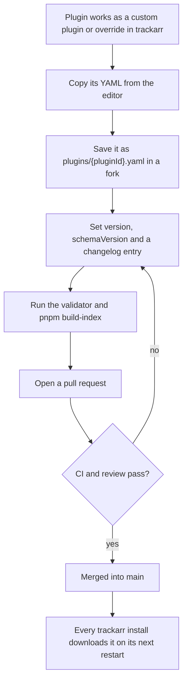

# Contributing

This guide covers how to test a plugin and how to submit it. The plugin format, plugin bases and the
`version` and `schemaVersion` rules are in the trackarr wiki, in
[Plugin reference](https://github.com/leandrobattochio/trackarr/wiki/Plugin-Reference); [Writing a plugin](https://github.com/leandrobattochio/trackarr/wiki/Writing-a-Plugin) explains how
to read a tracker's stats, step by step. [README.md](README.md) explains this repository and how
trackarr downloads it.

## Contents

- [Testing a plugin](#testing-a-plugin)
- [Submitting a plugin](#submitting-a-plugin)

## Testing a plugin

You need Node 22+ with [pnpm](https://pnpm.io/), and the
[.NET 10 SDK](https://dotnet.microsoft.com/download) with a clone of
[trackarr](https://github.com/leandrobattochio/trackarr) for the validator.

### 1. Validate the file

Run the trackarr validator, which applies the same rules as the app (schema, `pluginId` format,
engine-owned fields, `version` and `schemaVersion`) and checks that each file name equals its
`pluginId`. `--bases bases` also checks every base and resolves `extends` with them:

```bash
dotnet run --project ../trackarr/backend/tools/TrackerStats.PluginValidator -- --bases bases plugins/*.yaml
```

It prints `OK` or `INVALID` with the reason for each file, and exits non-zero when any file is
invalid. Adjust `../trackarr` to where you cloned it.

### 2. Build the index

```bash
pnpm install
pnpm build-index
```

This regenerates `index.json` and fails on a duplicate id, a file name that differs from its id,
an `extends` that names no file in `bases/`,
a malformed `version`, `schemaVersion` or `changelog`, or a plugin whose content changed since
your last commit without a higher `version`. CI runs the same check against the target branch.

### 3. Run it against the tracker with Test

The validator only checks the format. To check that the regexes and paths really match the
tracker, use the **Test** button in trackarr's plugin editor. It validates the YAML, then runs it
once with the settings of an integration you pick, and shows the outcome, the HTTP status of each
step, the extracted stats and the first field that failed. It saves no snapshot and does not
change the integration. Test needs an integration of that plugin:

- **Changing an official plugin:** open it on the Plugins page and edit it. Saving creates an
  override, which only your install uses. Pick an existing integration of that plugin and press
  **Test**.
- **A new plugin:** create it with **New plugin**, paste your YAML and save; it becomes a custom
  plugin. Create an integration for it with your tracker credentials, then return to the editor
  and press **Test**.

Credentials stay in your trackarr instance. Never paste a cookie, API key or test response that
contains one into an issue or pull request.

### 4. Optional: load the repository as the plugin source

To see your branch exactly as users will receive it, point trackarr at your clone and restart it:

```bash
PluginSource__Url=file:///path/to/trackarr-plugins/
```

Run `pnpm build-index` first: trackarr rejects any file whose SHA-256 does not match
`index.json`. An override or custom plugin with the same id still wins over the official one, so
remove it before testing this way.

## Submitting a plugin

New plugins and fixes are submitted as pull requests to this repository. trackarr cannot open them
for you.



### Promote a custom plugin

1. Make sure it works: **Test** returns `success` with the stats you expect.
2. Fork this repository and create a branch.
3. Copy the YAML from trackarr's editor into `plugins/<pluginId>.yaml`. Keep the same `pluginId`
   so your integrations keep pointing at it, unless an official plugin already has that id.
4. Set `version: 1.0.0`, `schemaVersion: 1` and a `changelog` entry for `1.0.0` dated today. If
   the tracker runs software that already has a base, such as UNIT3D, copy a plugin that extends
   it instead and change only `pluginId`, `displayName`, `changelog` and `baseUrls`.
5. Check that every credential field has `sensitive: true` and a `description` that tells a new
   user where to find the value.
6. Run the validator and `pnpm build-index`, and commit the plugin with the regenerated
   `index.json`. CI fails when `index.json` is out of date.
7. Open a pull request. Describe the tracker, which account types you tested with, and paste the
   Test outcome without any secret.

After the merge, your install keeps using your custom copy: a custom plugin always wins over an
official one with the same id, and trackarr shows a notice that an official version exists. To
switch to the official plugin, delete the custom one on the Plugins page. trackarr only allows
that once no integration uses it.

### Submit a fix to an official plugin

1. Edit the plugin in trackarr and **Test** it with your integration, as in step 3 above.
2. Copy the YAML into `plugins/<pluginId>.yaml` in your fork.
3. Bump `version` by the [version rules](https://github.com/leandrobattochio/trackarr/wiki/Plugin-Reference#version) and add a `changelog` entry.
4. Run the validator and `pnpm build-index`, and commit the plugin with the regenerated
   `index.json`. Then open a pull request.
5. After the merge and a restart, your install shows that a newer official version exists. Press
   **Use official** to drop your override and receive future updates automatically.
