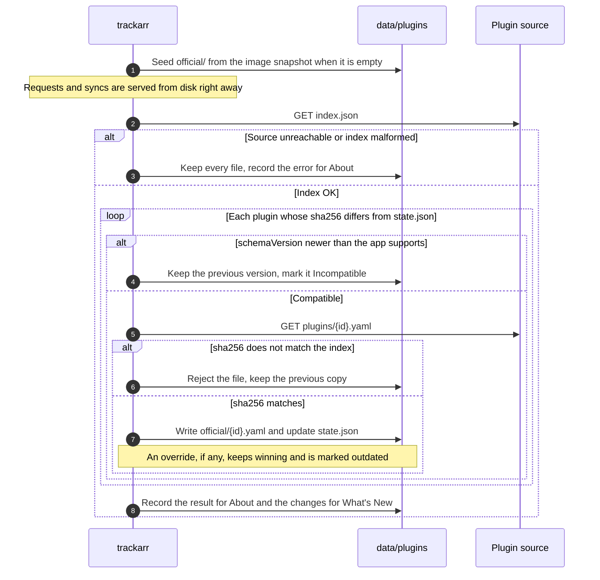

# trackarr-plugins

Official tracker plugins for [trackarr](https://github.com/leandrobattochio/trackarr).

A plugin is a YAML file that tells the trackarr engine how to log in to a tracker, which pages or
API endpoints to request, how to extract the stats from the responses and how to show them on the
dashboard. trackarr v0.4.0 and later download the plugins in this repository on every startup, so
a fix merged here reaches every install on its next restart, without a new app image.

To write or change a plugin, read [CONTRIBUTING.md](CONTRIBUTING.md).

## Layout

| Path | Content |
| --- | --- |
| `plugins/<pluginId>.yaml` | One official plugin per file. The file name equals the plugin's `pluginId`. |
| `index.json` | The list of plugins trackarr downloads. Generated by `pnpm build-index`; do not edit it by hand. |
| `scripts/build-index.mjs` | Validates the plugin files and writes `index.json`. |
| `.github/workflows/ci.yml` | Validates every plugin and checks that `index.json` is up to date. |

Current plugins: `asc`, `bj-share`, `capybarabr`, `fearnopeer`, `myanonamouse` and `seedpool`.

## `index.json`

`index.json` lists every official plugin, sorted by id:

```json
{
  "plugins": [
    {
      "id": "asc",
      "version": "1.0.0",
      "schemaVersion": 1,
      "path": "plugins/asc.yaml",
      "sha256": "7ae46b1cd365660af57e21090fc6b1974bbb58658e44c10530d1dbb09581d2a1",
      "changelog": [
        {
          "version": "1.0.0",
          "date": "2026-11-07",
          "notes": "First release in the trackarr-plugins repository."
        }
      ]
    }
  ]
}
```

| Field | Type | Meaning |
| --- | --- | --- |
| `id` | string | The plugin's `pluginId`. |
| `version` | string | The plugin's semver `version`. |
| `schemaVersion` | integer | The YAML format the plugin uses. trackarr skips versions it cannot run. |
| `path` | string | The YAML file, relative to the repository root. |
| `sha256` | string | Lowercase hex SHA-256 of the file's bytes as stored in git. |
| `changelog` | list | The plugin's `changelog` entries, copied from the YAML: `{version, date, notes}`. |

Every value comes from the YAML files, so the index is a pure function of `plugins/`. It carries no
timestamp or commit: regenerating it from the same files gives the same bytes, and its hash
identifies it. `plugins/*.yaml` is marked `-text` in `.gitattributes` so that line-ending
conversion never changes the hashed bytes.

## CI

On every pull request and every push to `main`, the `validate` job:

1. checks out `trackarr` `main` and runs its plugin validator
   (`backend/tools/TrackerStats.PluginValidator`) on `plugins/*.yaml`, so each plugin is checked
   with the same rules the app applies;
2. runs `scripts/build-index.mjs`, which fails when two files share an id, a file name differs
   from its `pluginId`, a file in `plugins/` is not `.yaml`, a field is malformed, or a changed
   plugin did not increase its `version`, or the committed `index.json` differs from the one it
   generates.

`index.json` is committed together with the plugin files it lists, so trackarr never reads an
index from one commit and the plugin files from another.

## How trackarr uses this repository

The plugin source defaults to `https://raw.githubusercontent.com/leandrobattochio/trackarr-plugins/main/`.
The `PluginSource__Url` environment variable points trackarr at a fork, a mirror or a local folder
(`file:///path/to/trackarr-plugins/`) with the same layout.

trackarr keeps its plugins under `<Data:Directory>/plugins/` (`/data/plugins/` in Docker):

| Folder | Written by | Content |
| --- | --- | --- |
| `official/` | the download only | The plugins from this repository. |
| `overrides/` | the plugin editor | A user's edited copy of an official plugin, plus the official copy it was based on. |
| `custom/` | the plugin editor | Plugins the user created. The download never touches them. |
| `state.json` | trackarr | The installed version and sha256 of each official plugin, and the base of each override. |

On startup:

- If `official/` is empty, trackarr seeds it from the snapshot of this repository that the Docker
  image embeds at build time, so a first boot without internet still has plugins.
- In the background, without delaying requests or integration syncs, trackarr downloads
  `index.json` and every file whose `sha256` differs from the installed one.
- A file whose SHA-256 does not match the index is rejected and the previous copy is kept. An
  unreachable or malformed index changes nothing on disk.
- A version whose `schemaVersion` is newer than the app supports is skipped. The previous version
  stays, labelled Incompatible, with a message to update trackarr.
- A plugin without an override is replaced, and its changelog appears in What's New.
- A plugin with an override is downloaded, but the override keeps winning. The app warns that a
  newer official version exists, shows both diffs, and offers **Use official** and **Keep mine**.
- A plugin removed from the index keeps working while an override or an integration uses it
  (labelled Orphan or Deprecated), and disappears from the list otherwise.
- The result (time, source, index hash, per-plugin outcome and errors) is shown in Settings, About.



## Local development

```bash
pnpm install
pnpm build-index    # validates plugins/ and rewrites index.json
```

See [CONTRIBUTING.md](CONTRIBUTING.md) for running the trackarr validator and testing a plugin in
the app.
